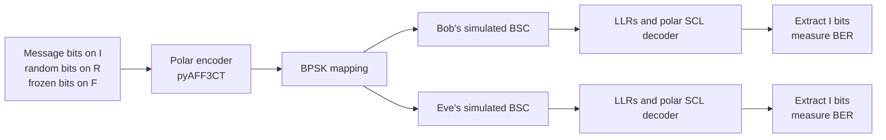

# POLARIS — polar codes for a wiretap channel

POLARIS is a **seven-person ENSEIRB-MATMECA telecommunications team project** (Semester 8, 2025–26). We built a software demonstrator of physical-layer security with polar codes: Alice sends the same encoded signal through separate simulated channels to Bob, the intended receiver, and Eve, an eavesdropper. The project tests whether Bob can recover the message when his channel is better than Eve's. This public portfolio copy contains a snapshot of the team's work, not the original team repository's commit history.

## The problem and the coding choice

In Wyner's wiretap model, Alice wants reliable communication with Bob while limiting what Eve can learn. The simulated binary symmetric channels (BSCs) make that advantage explicit: Bob's bit-flip probability is lower than Eve's. Polar coding transforms a length-$N$ channel into synthetic subchannels of very different quality. Selecting subchannels solely for Bob's reliability can still leave message bits on positions that Eve can also observe well.

POLARIS estimates each synthetic subchannel's quality for **both** receivers using Bhattacharyya parameters and partitions positions into:

| Set | Selection and purpose |
| --- | --- |
| **I** | Reliable for Bob, poor for Eve; carries message bits. |
| **R** | Reliable for Bob and more accessible to Eve; carries fresh random bits. |
| **F** | Not selected for Bob; frozen to known values. |

For the reported validation run, the construction first chose the best Bob subchannels at **85% of Bob's BSC capacity**, then placed those with $Z_{Eve}>0.60$ in **I**. This finite-length backoff was an empirical design choice to improve Bob's decoding reliability, not a general security proof.

## Simulation architecture



The Python modules in `fonctions/` construct the polar code, simulate channels, and calculate metrics. `main_simulation.py` runs the transmission chain and stores JSON results; the Flask interface presents the Alice/Bob/Eve demonstration. The reported wiretap validation concerns the **BSC mode**. The AWGN path uses a standard polar-code mask, and the planned over-the-air SDR path was not validated on physical radios.

## Reported results

The **seven-person team's final report** records the following **200-frame BSC validation** with $p_{Bob}=0.05$, $p_{Eve}=0.25$, and the reported selection rule. BER is measured on message bits in **I**; mutual information (MI) is the **average calculated synthetic-subchannel MI on I**, not an empirical leakage measurement from received messages.

| Block length $N$ | SCL list $L$ | $|I|$ | Bob BER | Eve BER | Bob MI on I | Eve MI on I |
| ---: | ---: | ---: | ---: | ---: | ---: | ---: |
| 128 | 1 | 49 | 0.0213 | 0.3047 | 0.9414 | 0.0701 |
| 512 | 8 | 194 | 0.0070 | 0.2918 | 0.9649 | 0.0387 |
| **1024** | **8** | **385** | **0.0035** | **0.2925** | **0.9719** | **0.0272** |

At $N=1024$, Eve's BER was about **84 times** Bob's in the team's reported run. An independent calculation using the repository's subchannel formulas matches $|I|=385$ and the reported MI values for that configuration. The BER figures are **reported team results, not an exactly reproduced run**: the report does not provide a random seed or frame-level data. They show a gap under the stated simulation assumptions, not a validated radio link or a proof of end-to-end secrecy. See [results and reproduction notes](docs/results-and-reproduction.md).

## Team and my contribution

**Team:** Karim Diop (project lead), Amine Aït El Amiri, Ethan Garchery, Meryem Benzakri, Assia Ouezghari, Jean Maureille, and Mohamed Badra. Romain Tajan supervised the academic project.

I worked in the digital communications subgroup. My contributions in the original team project included integrating the Wyner wiretap mode into the simulation, selecting and validating the I/R/F subchannels for BSC operation, adding BER validation and parameter-sweep scripts, revising the finite-length Bob subchannel selection and decoder settings, and integrating an optional privacy-amplification step. The full demonstrator, interface, and other modules are team work; the result table is a **team result**.

The project received **mentorship from Thales** as part of the academic program. The code and analysis here are attributed to the student team; mentioning mentorship does not imply Thales developed, reviewed, or endorsed this repository.

## Explore the code

- [`main_simulation.py`](main_simulation.py): end-to-end transmission and Wyner BSC mask used by the application.
- [`fonctions/fx_construction_z.py`](fonctions/fx_construction_z.py) and [`fonctions/fx_construction_mi.py`](fonctions/fx_construction_mi.py): synthetic-subchannel construction.
- [`tests/test_wiretap_ber.py`](tests/test_wiretap_ber.py) and [`tests/test_parametres.py`](tests/test_parametres.py): stochastic BER validation and parameter sweep.
- [Original technical README](docs/technical-reference.md): module-level documentation retained from the team repository.

## Run the software simulation

Use a Python interpreter compatible with your pyAFF3CT and pyStreamPU builds. The repository does not pin versions of these compiled bindings or provide a lockfile.

For a quick code check **without** the compiled bindings or a running server, run the construction and gallery-path tests:

```bash
python3 -m venv .venv
source .venv/bin/activate  # macOS/Linux
python -m pip install -r requirements-python.txt
python -m pytest tests/test_constructions.py tests/test_gallery_paths.py
```

The construction tests above use only the standard Python dependencies. To run the end-to-end simulation, install compatible [`py_aff3ct`](https://github.com/aff3ct/py_aff3ct) and [`pystreampu`](https://github.com/aff3ct/pystreampu) bindings for **that same interpreter**; they provide the `aff3ct` and `streampu` imports used here. They are not included in `requirements-python.txt` because this project does not provide a verified one-command installation for them. Check the environment before starting the application:

```bash
python -c "import aff3ct, streampu; print('bindings available')"
```

From the repository root, start the central server and interface in separate terminals with the same environment activated:

```bash
python server.py  # terminal 1: localhost:5000
python app.py     # terminal 2: localhost:5001
```

Open `http://localhost:5001` and choose the offline simulation mode. The interface's radio-mode scripts are not part of this repository, and the SDR link was not validated on hardware. For the team's standalone BER scripts, see [results and reproduction notes](docs/results-and-reproduction.md).

The optional C++ extension requires CMake, a C++ compiler, and CMake packages for pybind11, cpptrace, and StreamPU. After those are available, build with `cmake -S cpp -B cpp/build` and `cmake --build cpp/build`, then run `python cpp/tests/test_cpp.py`. Set `POLARIS_CPP_BUILD_DIR` if the built `my_module` extension is elsewhere. This C++ path is separate from the reported Python BER validation.

**Scope:** This is an academic simulation and demonstration. It assumes configured channel qualities, with Bob's channel better than Eve's.
